I'm an MS Computer Science student at FAST-NUCES, working on **hallucination mitigation in retrieval-augmented generation (RAG)**: getting language models to answer only what their sources support, and to say so when they can't.

**Interests:** RAG · LLM evaluation · low-resource languages (Urdu)

### 🔬 Featured project: [Urdu Token Tax](https://github.com/Mamuna-Safdar/urdu-token-tax)

How many more tokens do AI models need for Urdu than for English? Across 20 sentences and 4 tokenizers, Qwen needs **~2.9×** the tokens for Urdu, and Roman Urdu is **not** a cheaper alternative.

### 🛠️ Currently
- Rebuilding a full RAG pipeline from scratch: retrieval, reranking and evaluation
- Revising data structures and algorithms in Python
