I work on **hallucination mitigation in retrieval-augmented generation (RAG)**: getting language models to answer only what their sources support, and to say so when they can't.

### 🛠️ Currently
- Rebuilding a full RAG pipeline from scratch: retrieval, reranking and evaluation
- Revising data structures and algorithms in Python
